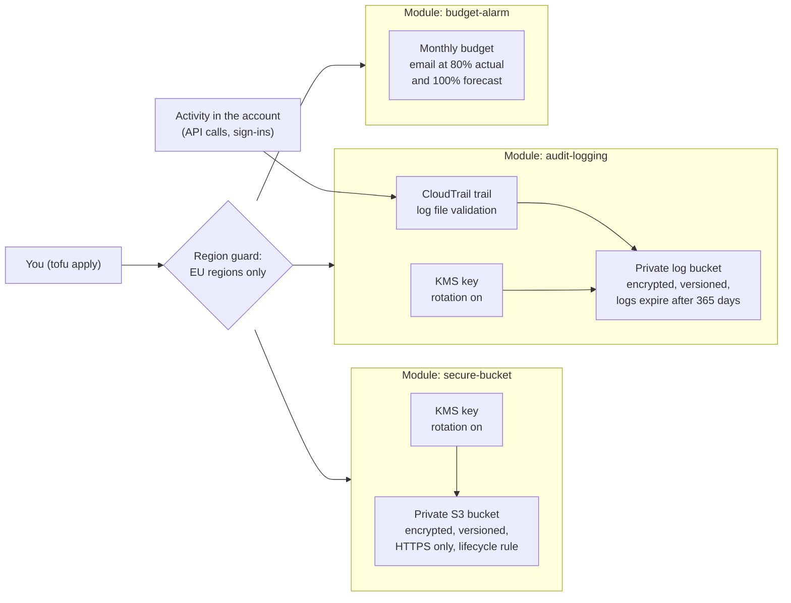

# Architecture

This is what the baseline builds in one AWS account, in one EU region.
The lab account runs in eu-north-1 (Stockholm).

## Notes

- Everything is created with OpenTofu, so it can be reviewed, repeated and removed.
- The region guard stops a plan if the region is not on the EU list.
- Each module can be used on its own.
- Left out on purpose (see `scan-decisions.md`): cross-region replication, S3 access logging, CloudWatch Logs, SNS notifications, multi-region trail on the Free plan.
